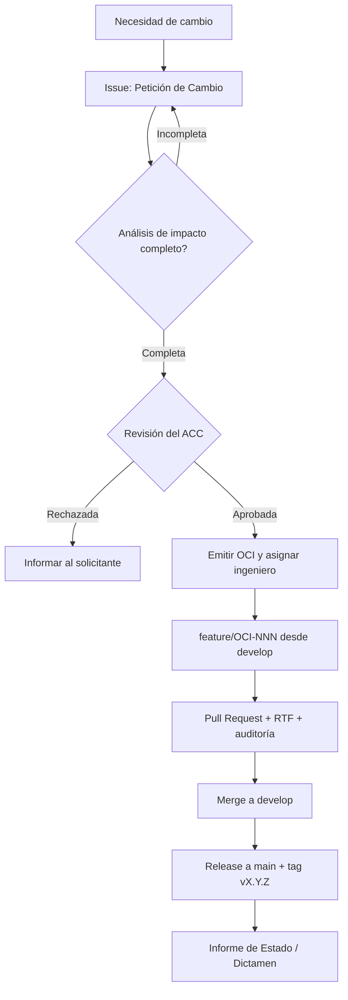

# CadenaFría Urabá

Sistema de inventario y **cadena de frío** para cooperativas pesqueras de Necoclí y Turbo (Urabá, Antioquia):
monitoreo de temperatura de cavas, registro de ingreso/salida de producto marino y alertas críticas (> -18 °C).

> Proyecto académico — Ingeniería de Software 2, Corporación Universitaria Remington · **Parcial II: Gestión de Configuración de Software (GCS)**.
> Autor / Líder de GCS: Jean David Londoño. Prototipo UI/UX (Parcial I): [Figma](https://www.figma.com/make/inuoToyAScgBHRwescveK6/Jean?fullscreen=1&t=h4Z3ukcpmP73w7NG-1&code-node-id=0-6)
> El código es un **esqueleto de referencia** que materializa la arquitectura del Parcial I (Adapter + Observer, orientada a eventos) para demostrar el control de configuración.

| Versión estable | Línea base | Rama de integración |
|---|---|---|
| `v1.0.0` | LB-1 | `develop` |

## 1. Catálogo de Elementos de Configuración de Software (ECS/EGC)

Clasificación del módulo (Unidad 2, Tema 1): **Programas**, **Datos** y **Documentación**.
Todo ECS tiene identificador único, ruta, responsable y versión de línea base.

### 1.1 Programas

| ID | Elemento | Tipo | Ruta | Historias | Versión |
|---|---|---|---|---|---|
| ECS-PRG-01 | Modelo de dominio y umbrales | Fuente | `src/cadenafria/domain.py` | HU-01, HU-04 | 1.0.0 |
| ECS-PRG-02 | Inventario de lotes | Fuente | `src/cadenafria/inventario.py` | HU-02, HU-03 | 1.0.0 |
| ECS-PRG-03 | Adaptadores de termómetros (Adapter) | Fuente | `src/cadenafria/adapters.py` | HU-07 | 1.0.0 |
| ECS-PRG-04 | Cava y observadores de alerta (Observer) | Fuente | `src/cadenafria/observers.py` | HU-01, HU-06, HU-08 | 1.0.0 |
<!-- ECS-PRG-NEXT -->
| ECS-PRG-10 | Vistas / pantallas: Inicio de sesión, Panel de cavas, Registro de producto, Reportes y alertas | Fuente (vistas) | [Prototipo Figma](https://www.figma.com/make/inuoToyAScgBHRwescveK6/Jean?fullscreen=1&t=h4Z3ukcpmP73w7NG-1&code-node-id=0-6) | HU-05 | 1.0.0 |
| ECS-PRG-11 | Pruebas automáticas | Fuente (pruebas) | `tests/` | todas | 1.0.0 |
| ECS-PRG-12 | Pipeline de integración continua | Configuración | `.github/workflows/ci.yml` | — | 1.0.0 |
| ECS-PRG-13 | Paquete distribuible (ejecutable) | Ejecutable generado | `dist/` (no versionado; se publica como *Release*) | — | 1.0.0 |

### 1.2 Datos

| ID | Elemento | Tipo | Ruta | Versión |
|---|---|---|---|---|
| ECS-DAT-01 | Esquema de la base de datos propia | Datos internos | `data/schema.sql` | 1.0.0 |
<!-- ECS-DAT-NEXT -->
| ECS-DAT-10 | Lecturas de termómetros por marca (A: °F/ISO; B: décimas °C/epoch) | Datos externos (sensores IoT) | contrato en `src/cadenafria/adapters.py` | 1.0.0 |

### 1.3 Documentación

| ID | Elemento | Ruta | Versión |
|---|---|---|---|
| ECS-DOC-01 | Especificación arquitectónica | `docs/arquitectura/arquitectura-eventos.md` | 1.0.0 |
| ECS-DOC-02 | Manual técnico | `docs/manual-tecnico.md` | 1.0.0 |
| ECS-DOC-03 | Manual de usuario | `docs/manual-usuario.md` | 1.0.0 |
| ECS-DOC-04 | Prototipo UI/UX | `docs/prototipo/README.md` | 1.0.0 |
| ECS-DOC-05 | Procedimiento de control de versiones y cambios | `CONTRIBUTING.md` | 1.0.0 |
| ECS-DOC-06 | Historial de cambios | `CHANGELOG.md` | 1.0.0 |
<!-- ECS-DOC-NEXT -->

## 2. Control de cambios



Detalle completo en [`CONTRIBUTING.md`](CONTRIBUTING.md): estrategia de ramas, convención de commits y SemVer.

## 3. Ejecutar las pruebas

```bash
PYTHONPATH=src python -m unittest discover -s tests -v
```
