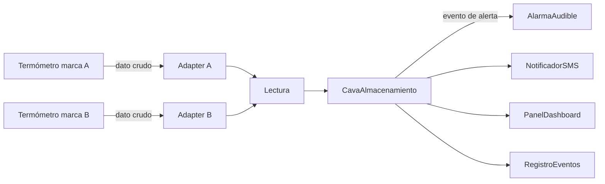

# ECS-DOC-01 · Especificación arquitectónica (resumen)

Fuente: Parcial I (prototipo UI/UX y estrategia ágil con Scrum).

* **Estilo:** arquitectura orientada a eventos. Cada cava publica lecturas de temperatura como eventos y el sistema reacciona.
* **Patrón Adapter** (`adapters.py`): aísla las diferencias entre marcas de termómetros (HU-07).
* **Patrón Observer** (`observers.py`): `CavaAlmacenamiento` notifica a `AlarmaAudible`, `NotificadorSMS`, `PanelDashboard` y `RegistroEventos` (HU-01, HU-06).
* **Resiliencia** (HU-08): el fallo de un observador no bloquea a los demás.
* **Requisitos no funcionales:** umbral crítico > -18 °C; alerta crítica en ≤ 30 s; operación con humedad salina y cortes eléctricos.

