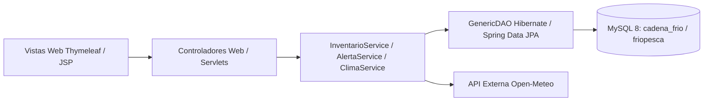

# Especificación Arquitectónica — CadenaFría Urabá / FríoPesca

* **Estilo arquitectónico:** Arquitectura en capas en Java (Presentación / Controladores, Servicios de Negocio, Acceso a Datos DAO/Repository y Modelo ORM con Hibernate 6) aplicando los principios SOLID.
* **Mapeo Objeto-Relacional (ORM):** Hibernate 6 mapea las entidades (`Cooperativa`, `Usuario`, `Cava`, `Producto`, `LoteInventario`, `LecturaTemperatura`, `Alerta`, `Lote`, `Movimiento`) al motor relacional MySQL 8.
* **Integración Externa:** Consumo de la API REST de **Open-Meteo** para correlacionar la temperatura y humedad ambiente exterior de Urabá (Necoclí / Turbo) con el monitoreo de las cavas y refrigeradores.
* **Control de Cadena de Frío:** Validación automática de rangos térmicos por lote y umbral crítico de cava (`-18.00 °C`), generando alertas históricas ante desviaciones térmicas.

